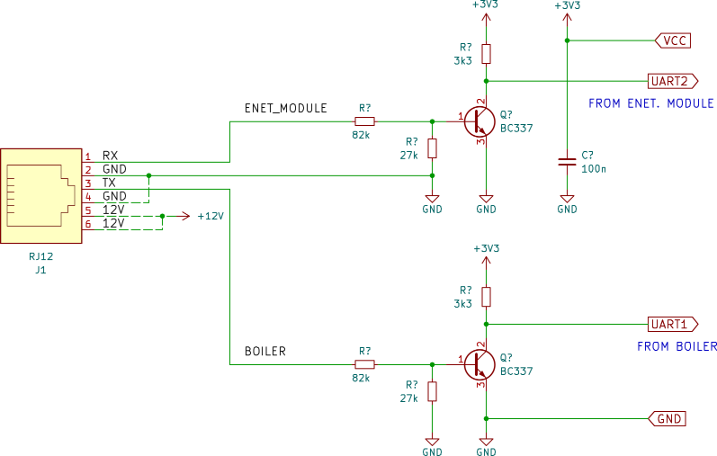
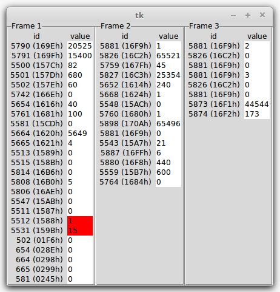
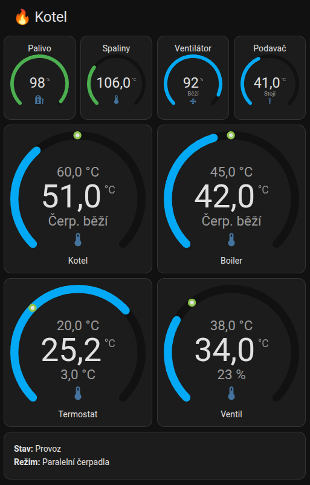

# TECH EL-480 communcation

Let's find out how TECH EL-480 controller communicates to the modules and how to get some data out of it.

## Start point

Having a boiler equiped with TECH EL-480 I want to get the field data out of it. I want to add the values to my home automation system, let say MQTT and some DB to store it. I thought I buy profi module for the purpose, but I found out TECH ST-505 quite useless. But it's good start point to fetch some communication and to mimic it ...
The (only) resource I found: https://www.elektroda.pl/rtvforum/topic2689981.html

## Sniffing

Couldn't find much documentation, I grabbed some multimeter and osciloskope. Signals measured. Found TX, GND and RX signal. Signal are supposed to be kinda RS232, inverted, 9k6, 8bit no parity 1.5stop. Let's make the convertor to standard levels first ...

Much later, 10 years o so, I found [similar project](https://github.com/agirilovich/Tech_RS-mqtt-gateway) where signals were described. I wasn't wrong, that time, thought.

### Converter

Converter schematic can be found in `converter/` directory. This one is one direction, sniffer. For both channels, to and from the boiler.

~~Well, the schematic needs some improvements. One of the signals is inverted (probably the one comming from ethernet module). I'm solving it with "SW inverter" on the launchpad - not perfect. Don't belive the data comming form enet module.~~

Nevermind, I've writen simple mqtt client throwing data into broaker. Than I've build simple app to get those "raw" data and show it. It also highlights the changes. Here you are:

## Tiva LaunchPad connections

Converter (see the schematic above) to EK-LM4F120XL LaunchPad, firmware in `tiva/`:

| Converter | LaunchPad | Function |
|-----------|-----------|----------|
| UART1 (BOILER, RJ12 pin 3) | PB0 (U1RX) | shown as `U1`, green LED |
| UART2 (ENET_MODULE, RJ12 pin 1) | PD6 (U2RX) | shown as `U2`, red LED |
| GND (RJ12 pin 2) | GND | common ground |
| VCC | LaunchPad supply | pull-up supply for the transistors |

Output goes through the debug USB (UART0, 115200 8N1), which shows up as `/dev/ttyACM0` on Linux. Both inputs are 9600 8N1 and receive only, the sniffer can't transmit to the bus.

Update 2026-11-04: UART2 now goes straight to PD6. It used to go to PA3, with PA4 linked to PD6, through the "SW inverter" in `project.c`. That inverter was the reason for the bad `U2` data, so the note above about not believing the enet module data no longer applies. All frames in both directions now pass the CRC. The inverter code is still in the firmware, but PA3 and PA4 are no longer connected.

## Protocol

Serial 9600 8N1 on the bus. A frame is made of big-endian 16-bit words:

    0226  address  (param value)...  0218  crc

- **CRC:** start `FFFF`, reflected polynomial `0x8408`, no final XOR. It covers the bytes before the `0218` end marker. It passes on all captured frames in both directions.
- **Addresses:** the boiler polls `FFF4` (Ethernet module) and `FFFA` (room unit). The values they share are identical, and only `FFF4` carries the room readings, so the server prefers it.
- **Selectors:** `16F9` and `16EF` say which valve or room unit the following values belong to.
- **U2 frames:** each ends with one extra `00` outside the CRC, probably the sender releasing the line.

Param names are in `server/params.py`. They come from `listener/decode.py`, [Tech_RS-mqtt-gateway](https://github.com/agirilovich/Tech_RS-mqtt-gateway) and my own guesses, and they aren't all checked against the controller's display. Some params are still unknown.

## Server

`server/` runs on a Raspberry Pi with the sniffer on its USB port. One service reads the sniffer, checks each frame's CRC, then:

- stores values in SQLite (`kotelna.db`)
- serves a local web page
- publishes to Home Assistant over MQTT

It only listens: the sniffer hardware can't transmit, so nothing here can change anything on the boiler.

### Install

Needs Python 3.11 or newer. MQTT also needs paho-mqtt 2.x:

    sudo apt install python3-paho-mqtt

Copy the server files (not the tests) to `~/kotelna` on the Pi, then run it as a service:

    sudo cp ~/kotelna/kotelna-reader.service /etc/systemd/system/
    sudo systemctl daemon-reload
    sudo systemctl enable --now kotelna-reader

The service file expects the user `pi` and the folder `/home/pi/kotelna`. While it's running, the serial port is locked, so stop the service before using `minicom`.

### Web page

`http://<pi address>:8080` shows the readings, plus a filterable table of all raw values to help identify unknown params. `/api/values` returns the same data as JSON. There's no password, so keep it on the local network.

### Home Assistant

Create `~/kotelna/mqtt.toml` with `chmod 600`. It holds a password, so keep it out of git. Without this file, MQTT stays off and everything else still runs.

    host = "192.168.1.x"
    port = 1883
    username = "kotelna"
    password = "..."

A **Kotelna** device then appears in Home Assistant through MQTT discovery. Each value has its own retained topic with a plain text payload, like `kotelna/boiler_temperature`. `kotelna/availability` goes `offline` if the service dies or no boiler data arrives for 30 seconds.

To remove the entities, stop the service and run `python3 ~/kotelna/mqtt_pub.py --remove`.

### Dashboard

`ha/dashboard.yaml` is a Home Assistant dashboard card with Czech labels.

The top row has four small gauges: fuel level, flue gas temperature, fan power and feeder temperature, with the fan and feeder on/off state under the last two. Below are four large gauges, for the boiler, hot water, room and valve temperatures, each with its setpoint above the temperature and as a dot on the arc. The text under the temperature is the pump state on the boiler and hot water gauges, the outside temperature on the room gauge, and the valve opening on the valve gauge. A text card at the bottom shows the boiler state and pump mode.

When `kotelna/availability` goes `offline`, all of this is replaced by a communication error message under the title. The cards check this through `sensor.kotelna_boiler_state`, which becomes `unavailable`.

It needs the [Modern Circular Gauge](https://github.com/selvalt7/modern-circular-gauge) card, available through HACS, because the built-in gauge card can only mark fixed values. To use it, add a manual card in the dashboard editor and paste the file over its YAML.

The setpoint's `min` and `max` must match the gauge's own, or the dot lands in the wrong place. On the boiler gauge, the arc turns orange from 80 °C and red from 85 °C, the limits in the EL-480 manual.

### Database

- `current_values`: the latest value of every param
- `value_changes`: history, with a row only when a value changes
- `reader_stats`: good and rejected frames per hour

Writes are batched once a minute to limit SD card wear, so a power cut can lose up to a minute of data. Old history isn't cleaned up yet.

### Tests

    cd server && python3 -m unittest test_server

No boiler needed. The tests also use the 2017 captures in `listener/testfile.txt`.

# ToDo

- [ ] capture communication without ethernet module
- [ ] create better hw (omit tiva mcu)
